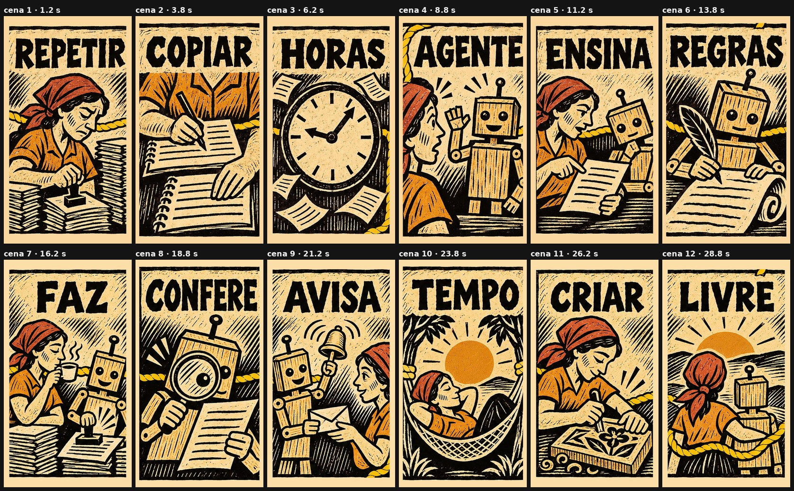

# estilo em skill

> Guia: (em breve)

**Você vê um vídeo explicativo com um visual que adora, tenta repetir e cada vídeo seu sai com uma cara
diferente. Com o método "estilo em skill", o seu Claude Code ou Codex aprende aquele ESTILO uma vez e passa
a fazer todo vídeo novo com a mesma cara: você só diz o tema.** Este kit faz isso e mostra que funciona.



## O que é

Um kit aberto que transforma o **estilo** (não o conteúdo) de um vídeo de referência numa **skill**
reutilizável. Depois de instalada, você dá só cinco dados (tema, formato, duração, resolução e motor) e a
skill planeja as cenas, desenha o storyboard no estilo, escreve a narração, anima, põe uma trilha única e
entrega `final/video-final.mp4` + `final/manifesto.json`, **conferidos por um script** antes de dizer "pronto".

```
vídeo de referência → quadros escolhidos sozinhos → a IA escreve a "bíblia do estilo" → skill instalada
   → storyboard (até 6 cenas de 2,5 s) → cenas animadas → narração numa voz só → trilha única → vídeo + manifesto + validação
```

## Para quem

Para quem cria vídeo (reels, shorts, explicativos), tem 30+ anos, não é programador e já usa o
**Claude Code** ou o **Codex**. Você não precisa escrever código: copia comandos e conversa com a IA.

## O que você precisa

| o quê | para quê | como conferir |
|---|---|---|
| Claude Code **ou** Codex | ver os quadros, escrever a bíblia, rodar a skill, gerar o storyboard | abrir no terminal |
| ffmpeg (traz o ffprobe) | cortar, animar, juntar, medir o áudio | `ffmpeg -version` |
| Python 3 | rodar os scripts | `python3 --version` |
| Pillow | mexer nas imagens | `python3 -c "import PIL"` (instalar: `python3 -m pip install --user Pillow`) |
| uma voz | narração | você grava, ou um TTS local (opcional: edge-tts) |
| uma música sua ou com licença | trilha | um `.mp3`/`.wav` |

Para o storyboard você precisa de uma ferramenta que gere imagem (no Codex, a `image_gen` da assinatura).

## O processo, do início ao fim

Legenda: 🧠 você com a IA · ⚙️ script · 🤖 a skill (a IA seguindo o `SKILL.md`)

| # | passo | comando | quem |
|---|---|---|---|
| 1 | Escolha o vídeo de referência (o estilo que você quer) | — | 🧠 |
| 2 | Tirar 5–8 quadros diferentes + folha de contato | `python3 scripts/quadros.py ref.mp4 --n 8 --saida estilo/quadros/` | ⚙️ |
| 3 | A IA olha os quadros e escreve a bíblia do estilo (paleta em hex, tipografia, composição, o que não fazer…) | colar `prompts/criar-skill.md` no Claude Code/Codex | 🧠 |
| 4 | Instalar a skill com a bíblia | `bash scripts/instalar.sh meu-estilo claude --estilo estilo/estilo.md` (ou `codex`) | ⚙️ |
| 5 | Pedir o vídeo: tema, formato, duração, resolução, motor | "use a skill meu-estilo para um vídeo sobre …" | 🧠 |
| 6 | Calcular cenas e storyboards → `saida/plano.json` | `cenas.py --tema … --duracao 30 --formato 9:16` | 🤖⚙️ |
| 7 | Escrever o roteiro (fala de até 6 palavras por cena, palavra-chave por cena) | `roteiro.json` + `cenas.py … --roteiro roteiro.json` | 🤖 |
| 8 | Montar o pedido de cada storyboard a partir do molde + bíblia | `pedido_storyboard.py` | ⚙️ |
| 9 | Gerar os storyboards, um por vez (o 2º recebe o 1º como referência), e OLHAR cada um | ferramenta de imagem → `saida/storyboards/storyboard-N.png` | 🤖🧠 |
| 10 | Cortar em painéis no formato do vídeo | `recortar.py --plano saida/plano.json` | ⚙️ |
| 11 | Animar (motor local: zoom/pan lento + dissolve) | `animar.py` | ⚙️ |
| 12 | Narração numa voz só, encaixada nas cenas | `narrar.py --arquivo voz.wav` (ou `--falas-dir`, `--comando`, `--inemavox`) | ⚙️ |
| 13 | Trilha única com ducking + vídeo final + manifesto | `montar.py` | ⚙️ |
| 14 | Conferir de verdade e olhar a folha final | `validar.py --duracao 30 --resolucao 1080x1920` e `folha.py` | ⚙️🧠 |
| 15 | Melhorar a skill com o que deu errado | anotar em `references/licoes.md` e mudar a regra | 🧠 |

Os comandos dos passos 6 a 14 ficam em `<skill>/scripts/` (ex.: `.claude/skills/meu-estilo/scripts/`).
A skill roda tudo isso sozinha; a tabela é para você saber o que acontece e conseguir rodar à mão.

## Cenas e storyboards

Cada cena dura **2,5 s**; cada storyboard tem **até 6 cenas** (15 s). Mais longo = vários storyboards,
gerados um de cada vez para manter a continuidade. Duração que não é múltiplo de 2,5 vai para o mais
próximo, com aviso (17 s → 17,5 s).

| duração | cenas | storyboards | grade (9:16) |
|---|---|---|---|
| 10 s | 4 | 1 | 2 × 2 |
| 15 s | 6 | 1 | 2 × 3 |
| 20 s | 8 | 2 | 2 × 2 + 2 × 2 |
| 30 s | 12 | 2 | 2 × 3 + 2 × 3 |
| 45 s | 18 | 3 | 2 × 3 × 3 |

Em 16:9 a grade cheia é 3 linhas × 2 colunas (a folha fica quase quadrada nos dois casos).

## Motores

| motor | estado | o que faz |
|---|---|---|
| `local` | **testado** | grátis, sem IA de vídeo: cada painel ganha um movimento de câmera lento (zoom até 1,25×, pan) e as cenas se ligam por dissolve, na duração exata |
| `kling` | **não testado neste kit** | `animar.py --motor kling --so-prompts` escreve os comandos `kling image_to_video` de cada cena para você rodar na SUA conta |
| `seedance` / `higgsfield` | **não testado neste kit** | `animar.py --motor seedance --so-prompts` escreve um prompt por storyboard (tempo de cada cena, câmera, texto, transição, fala, "sem música") para colar no site |

O kit não chama nenhuma API. Nos motores de IA, quem roda é você, na sua conta.

## O que o kit garante (e testa)

- `quadros.py` escolhe quadros **diferentes** sozinho: troca de cena do ffmpeg + descarte de parecidos
  (desenho e cor); vídeo com poucas trocas cai para quadros espaçados.
- `recortar.py` acha a calha entre os painéis (clara ou escura, mesmo com o fio condutor cruzando) e, se não
  achar, corta em grade fixa; aceita grade parcial; põe respiro para o zoom não cortar a palavra.
- `animar.py` não encurta o vídeo com o dissolve (30 s pedidos = 30 s entregues).
- `narrar.py` corta silêncio das pontas, acelera até 15% se precisar, avisa quando a fala não cabe e **recusa voz muda**.
- `montar.py` usa UMA trilha do começo ao fim (não reinicia), volume 0,5, abaixa sob a voz (ducking), fade no fim;
  sem trilha ele para e pergunta; com várias, pede para escolher.
- `validar.py` confere arquivos do manifesto, duração ±0,5 s, resolução, vídeo + áudio, áudio e narração que
  não são silêncio, trilha presente e `status: completo`. Se algo falha, sai com erro e diz o que falta.

Testes: `bash tests/rodar.sh` (sem pytest; imagens sintéticas e tons senoidais no lugar de voz e música).

## A demo: cordel

Para não usar quadro de vídeo de ninguém, o estilo de referência da demo é **próprio**: 6 quadros de
xilogravura de cordel (papel creme, preto chapado, ocre e vermelho terroso, letras entalhadas e um fio
amarelo que liga as cenas) gerados para este kit e juntados num vídeo curto
(`exemplos/cordel/referencia/referencia.mp4`). Daí o fluxo inteiro rodou:

- `estilo/quadros/` + `folha.jpg`: os quadros que o `quadros.py` escolheu sozinho
- `estilo/estilo.md`: a bíblia preenchida com o prompt do kit
- `skill/`: a skill `cordel` instalada
- `saida/storyboards/`: os 2 storyboards (e os pedidos montados pela skill), `saida/paineis/`: os 12 painéis
- `saida/plano.json`, `final/manifesto.json`, `final/video-final.mp4`, `final/folha-final.jpg`
- `LICOES.md`: o que deu errado entre as tentativas e o que mudou na skill

Tema: "Como um agente de IA tira o trabalho repetido do seu dia" — 30 s, 9:16, 1080×1920, 12 cenas,
2 storyboards, motor local, voz local, trilha própria.

Resultado (conferido pelo `validar.py`):

```
  ok   manifesto com status completo
  ok   30 arquivos do manifesto existem
  ok   duração 30.00 s (pedido 30 s ± 0,5)
  ok   resolução 1080x1920
  ok   áudio do vídeo com som (média -20.2 dB, pico -3.9 dB)
  ok   narração com voz (média -18.9 dB)
PASSOU: vídeo conferido, pode dizer pronto.
```

- MP4: 30,0 s, 1080×1920, 30 fps, H.264 + AAC, 23 MB. Render local (motor `local`): 78 s nesta máquina.
- Voz: TTS local (chatterbox, clonando uma voz de referência), 12 falas, nenhuma passando da cena. A voz
  local às vezes inventa um pedaço depois da frase: o `narrar.py` refez falas longas demais, cortou caudas
  baixas e a cena 3 foi refeita sozinha com `--refazer 3`. As 12 frases, conferidas com uma transcrição local
  (Whisper, `saida/voz/transcricao-conferencia.srt`), batem com o roteiro.
- Trilha: `assets/trilha/energia.mp3` (própria), volume 0,5, abaixando sob a voz.
- No repositório ficam os painéis em JPG (`paineis-jpg/`); os PNG, clipes e o vídeo mudo são gerados de novo
  ao rodar. Por isso, num clone, confira com `python3 skill/scripts/validar.py --sem-intermediarios`.

## Melhore a skill depois de cada teste

A skill não nasce pronta. Depois de cada vídeo, olhe a folha final e anote em `references/licoes.md` o que
saiu errado. Se o erro voltar, **mude a regra** (na bíblia, nas regras do storyboard ou no script), não só o
pedido. Na demo, pedir "palavra com no máximo 60% da largura" não adiantou duas vezes; a correção que
funcionou foi no script (`--respiro`). Veja `exemplos/cordel/LICOES.md`.

## Limites honestos

- **Resolução do storyboard**: a ferramenta de imagem entrega cerca de 1254×1254 por storyboard; cada painel
  sai com uns 370×600 px e é ampliado para 1080×1920. Estilos chapados (gravura, recorte, flat) aguentam bem;
  estilos com muito detalhe fino ficam moles.
- **Texto desenhado** depende da ferramenta de imagem: confira cada palavra com zoom. Palavras curtas e sem
  acento erram menos.
- **Motor local não anima o desenho**: é câmera passeando pela ilustração + dissolve. Para personagem se
  mexendo de verdade, use um motor de IA de vídeo (não testado aqui).
- **edge-tts** usa um serviço online e não foi testado neste kit; a demo usou TTS local. O modo `--inemavox`
  chama o `tts_direct.py` de uma instalação local do inemavox; a API HTTP dele (porta 8010) não está implementada.
- **Voz local inventa som**: o corte de cauda é conservador (só tira o que é bem mais baixo ou muito curto).
  Um "som" alto sem palavra depois da frase só é pego ouvindo ou transcrevendo; aí use `--refazer N`.
- **Continuidade** entre storyboards é pedida (o anterior vai como referência), mas não é garantida: confira.
- A bíblia é escrita pela IA olhando quadros: confira as cores e o "o que não fazer" antes de usar.
- Use só referências e músicas que você pode usar. O método copia a linguagem visual, não personagens, logos
  ou textos.

## Estrutura

```
scripts/quadros.py, scripts/instalar.sh      ← passo 2 e 4
prompts/criar-skill.md                       ← passo 3
molde/estilo-em-skill/                       ← a skill (SKILL.md, references/, modelos/, scripts/)
tests/rodar.sh                               ← testes
exemplos/cordel/                             ← a demo completa
```

## Licença

MIT © 2026 INEMA
